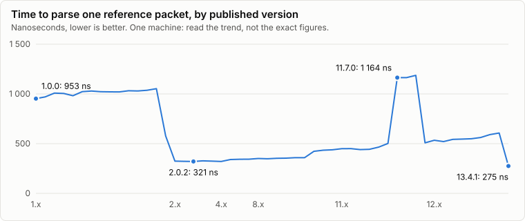

# packet_parser

[](https://github.com/Akmot9/Packet-parser/actions/workflows/ci.yml)
[](https://codecov.io/gh/Akmot9/Packet-parser)
[](https://crates.io/crates/packet_parser)
[](LICENSE.md)
[](https://docs.rs/packet_parser)
[](https://akmot9.github.io/packet-parser-book/)
[](https://app.codspeed.io/Akmot9/Packet-parser?utm_source=badge)

`packet_parser` is a Rust crate for parsing raw network packets. It starts at
the data-link layer and progressively decodes internet, transport and
application-layer information.

The main API is `PacketFlow`: a borrowed, zero-copy representation of a parsed
packet. Unknown or unsupported protocols above the data-link layer do not make
the whole parse fail. The crate keeps the layers it could decode and leaves the
next layers as `None` when parsing cannot safely continue.

[Version francaise](README-fr.md)


## Documentation

- **The book**, [akmot9.github.io/packet-parser-book](https://akmot9.github.io/packet-parser-book/):
  how the crate is designed, layer by layer, with diagrams and tested examples.
- **The API reference**, [docs.rs/packet_parser](https://docs.rs/packet_parser):
  every public type and function, with the wire format of each header drawn.
- **The reference**, [docs/reference.md](docs/reference.md): every protocol and
  LINKTYPE in detail, the JSON schema, tunnels, timing and benchmarks.
- **Contributing**, [CONTRIBUTING.md](CONTRIBUTING.md); history in
  [CHANGELOG.md](CHANGELOG.md), plan in [ROADMAP.md](ROADMAP.md).

## Installation

```toml
[dependencies]
packet_parser = "13.4.0"
hex = "0.4" # only to decode the hexadecimal dump of the example below
```

## Quick Example

```rust
use packet_parser::{LinkType, parse};

fn main() -> Result<(), Box<dyn std::error::Error>> {
    let raw = hex::decode(
        "feaa81e86d1efeaa818ec864080045500034000000003d06206b36e6700d\
         ac140a0201bbc1087d7f02aa4e2b998e80100081748300000101080a9373\
         c9c207ef14e3",
    )?;

    // Always pass the LINKTYPE the capture declares.
    let flow = parse(LinkType::ETHERNET, &raw)?;

    println!("L2: {}", flow.data_link);

    if let Some(internet) = &flow.internet {
        println!(
            "L3: {} {:?} -> {:?}",
            internet.protocol_name, internet.source, internet.destination
        );
    }

    if let Some(transport) = &flow.transport {
        println!(
            "L4: {:?} {:?} -> {:?}",
            transport.protocol, transport.source_port, transport.destination_port
        );
    }

    if let Some(application) = &flow.application {
        println!("L7: {}", application.protocol);
    }

    Ok(())
}
```

`parse` takes exactly one packet, without a PCAP or PCAPNG record header, and
the LINKTYPE the capture declares: it is never guessed from the bytes.
`PacketFlow::try_from(&[u8])` assumes Ethernet and silently produces wrong data
on anything else; it is kept for compatibility only.

| Need | API |
| --- | --- |
| Check whether a link decoder exists | `is_supported(LinkType)` |
| Parse a packet | `parse(LinkType, &[u8])` |
| Parse with caller-declared ports ("Decode As") | `parse_with(LinkType, &[u8], &ParseConfig)` |
| Add a parser for a protocol the crate does not decode, in the application or as a `.so`/`.dll` plugin | `ParseConfig::with_parser(Arc<dyn ApplicationParser>)`, see [docs/plugins.md](docs/plugins.md) |
| Name such a protocol from a TOML rule file, without code (feature `rules`) | `RuleSet::from_toml` then `ParseConfig::with_rules`, see [docs/rules.md](docs/rules.md) |
| Classify a payload without its frame, from its transport and ports | `classify_payload(TransportProtocol, Option<u16>, Option<u16>, &[u8])` |
| Detach the result from the buffer | `flow.to_owned_flow()` |
| Iterate over encapsulated flows | `flow.flatten()` |

## Supported LINKTYPEs

| LINKTYPE | Value | Status |
| --- | ---: | --- |
| BSD loopback (NULL) | 0 | Supported |
| Ethernet | 1 | Supported |
| RAW IP | 101 | Supported (IPv4 and IPv6) |
| IPv4 raw, IPv6 raw | 228, 229 | Supported |
| Linux SLL v1, v2 | 113, 276 | Supported |
| IEEE 802.3br mPacket | 274 | Express mPackets only |
| Native IEEE 802.11 | 105 | Inner flows of CAPWAP only |
| Bluetooth H4 | 201 | Identified, refused |
| Any other value | kept as-is | `ParseError::UnsupportedLinkType` |

## Protocols

- **Data link**: Ethernet II, VLAN 802.1Q, PPPoE session, STP, Linux cooked
  capture, RAW IP, BSD loopback.
- **Internet**: IPv4, IPv6, ARP, and directly over Ethernet: PROFINET, PTP,
  GOOSE, LLDP.
- **Transport**: TCP, UDP, ICMPv4, ICMPv6, ESP.
- **Application**, 56 labels: AMS, ASTERIX, BACnet/IP, Bitcoin, COTP,
  DCE/RPC, DHCP, DHCPv6, DIS, DNP3, DNS, ESP, EtherNet/IP, FTP, GIOP, HTTP,
  IEC 104, IKE, Java RMI, Kerberos, LDAP, LLMNR, mDNS, ModbusTCP, ModbusUDP,
  MQTT, NBDS, NBNS, NBSS, NMF, NNTP, NTP, ONC RPC, OPC UA, OpenVPN, PostgreSQL,
  PTP, QUIC, RADIUS, RDP, RTCP, RTP, RTPS, S7Comm, SIP, Skinny, SMTP, SNMP,
  SRVLOC, SSDP, SSH, Syslog, TLS, UMAS, Valmet DNA, WireGuard.
- **Tunnels**, peeled into `flow.inner`: CAPWAP-Data, GRE, IP-in-IP, VXLAN,
  Geneve, GTP-U.

Ports, detection route and decoded fields: [docs/reference.md](docs/reference.md#protocol-support)
and [the book](https://akmot9.github.io/packet-parser-book/).

## Guarantees

- **Zero copy**: `PacketFlow` borrows the packet; `to_owned_flow()` detaches it.
- **Fail-closed on the link layer, fail-soft above**: an unsupported LINKTYPE is
  an error; an unknown or damaged upper layer leaves the next layers at `None`
  and says where it stopped in `corrupted`.
- **No `unsafe`**; `unwrap`, `expect` and `panic!` are linted out of production code.
- **Checked against tshark**: the recent decoders, frame by frame on real
  captures; a golden histogram freezes the classification of the corpus.
- **Fuzzed every night** (39 targets); `cargo semver-checks` and a [benchmark](benches) on every pull request.
- **Semver covers everything public**, the protocol decoders included: a decoder
  changes by addition, or in a major release with its migration guide.
- **No system dependency**: pure Rust, tested on Linux and macOS.



Next to `etherparse` and `pnet_packet`, on the same frames from Ethernet to
TCP, UDP and ICMP: [docs/benchmark-l2-l4.md](docs/benchmark-l2-l4.md).

## Known Limitations

- No TCP reassembly, no IP reassembly.
- Application detection is heuristic and best-effort.
- The `parse_timing` path is for measurement, not the standard parsing path;
  it does not yet measure the `inner` flows produced by tunnel parsing.

## License

Distributed under the MIT license. See [LICENSE.md](LICENSE.md).
